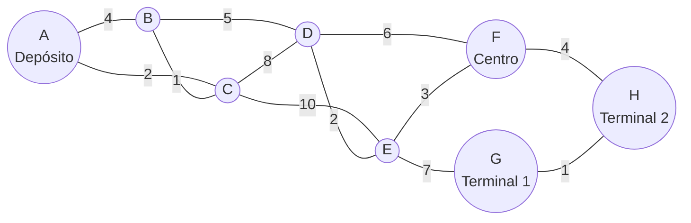

# TPO Programación III 2026 — Sistema de reparto

API de logística con **Spring Boot** y **Neo4j** que implementa los siete bloques
puntuables del Trabajo Práctico Obligatorio de Programación III (UADE): recorridos,
caminos mínimos y árboles de expansión, greedy, ordenamientos, programación dinámica,
backtracking y Branch & Bound.

## Integrantes

| Integrante | Legajo | Usuario de GitHub |
|---|---|---|
| Manuel Martinez de Vedia | 1205995 | manuelmartinez4 |

## Dominio

Una empresa de reparto necesita consultar su red de distribución, elegir la carga de
un vehículo y balancear paquetes entre varios camiones.

| Concepto del scaffold | En el dominio | Unidad |
|---|---|---|
| `Nodo` | depósito, punto de entrega, centro de distribución o terminal | — |
| `Conexion` (arista) | camino entre dos lugares, **bidireccional** | kilómetros ficticios (enteros positivos) |
| `Item` | paquete indivisible con peso, valor y lugar asociado | peso en kg (entero positivo), valor en puntos de beneficio |

### Red de distribución: 8 lugares y 12 caminos

| ID | Lugar | Tipo |
|---|---|---|
| A | Depósito central | DEPOSITO |
| B | Punto Norte | PUNTO_ENTREGA |
| C | Punto Este | PUNTO_ENTREGA |
| D | Punto Sur | PUNTO_ENTREGA |
| E | Punto Oeste | PUNTO_ENTREGA |
| F | Centro de distribución secundario | CENTRO_DISTRIBUCION |
| G | Terminal uno | TERMINAL |
| H | Terminal dos | TERMINAL |

Caminos (km): A-B 4, A-C 2, B-C 1, B-D 5, C-D 8, C-E 10, D-E 2, D-F 6, E-F 3, E-G 7, F-H 4, G-H 1.



La red es conexa, simple y todos los costos son positivos. El camino directo A-B
cuesta 4, pero A-C-B cuesta 3: así se nota la relajación de Dijkstra.

### Paquetes

| Paquete | Lugar | Peso (kg) | Valor | Valor/peso |
|---|---|---|---|---|
| P1 | B | 6 | 12 | 2,0 |
| P2 | C | 5 | 9 | 1,8 |
| P3 | D | 5 | 9 | 1,8 |
| P4 | E | 4 | 4 | 1,0 |
| P5 | H | 3 | 3 | 1,0 |

### Problemas que resuelve

- **Selección de carga** (greedy y mochila 0/1): elegir qué paquetes cargar en un
  vehículo de capacidad dada para **maximizar el valor** sin superar la capacidad.
- **Reparto** (Branch & Bound): asignar **todos** los paquetes a `k` camiones idénticos
  para **minimizar la carga del camión más cargado**. El contrato del scaffold recibe
  la cantidad de camiones y no capacidades individuales; la capacidad pertenece a los
  problemas de selección.

## Requisitos

- JDK 17 o superior (el proyecto compila con `--release 17`).
- Neo4j 5, local, en Docker o en Aura. **Base de desarrollo dedicada**: la carga
  sincroniza los datos del dominio.
- No hace falta instalar Maven: el proyecto trae Maven Wrapper.

## Configuración

Las credenciales **no** están en el código ni en `application.properties`. Se leen de
variables de entorno o de un archivo `.env` en la raíz del proyecto (está en
`.gitignore`):

```bash
cp .env.example .env    # en Windows: copy .env.example .env
```

| Variable | Default | Uso |
|---|---|---|
| `NEO4J_URI` | `bolt://localhost:7687` | conexión |
| `NEO4J_USER` | `neo4j` | usuario |
| `NEO4J_PASSWORD` | (vacío) | contraseña |
| `APP_SEED_ENABLED` | `true` | sincroniza la red y los paquetes al arrancar |
| `APP_SEED_ELIMINAR_AJENOS` | `true` | borra nodos e items que no son del dominio; con `false` solo los informa en el log |

Spring carga el `.env` con `spring.config.import=optional:file:.env[.properties]`, que
se resuelve **contra el directorio de trabajo**. Si se ejecuta desde el IDE con otro
directorio de trabajo, configurar las variables en la configuración de ejecución.

Neo4j con Docker, por ejemplo:

```bash
docker run -d --name neo4j-tpo -p 7474:7474 -p 7687:7687 -e NEO4J_AUTH=neo4j/cambiame neo4j:5
```

La contraseña de `NEO4J_AUTH` tiene que ser la misma que `NEO4J_PASSWORD` en el `.env`
(en el ejemplo, `cambiame`; Neo4j 5 exige al menos 8 caracteres). Si se cambia una, hay
que cambiar la otra.

## Ejecución

```bash
./mvnw test               # tests (no necesitan Neo4j)
./mvnw spring-boot:run    # levanta la API en http://localhost:8080
curl "http://localhost:8080/api/grafo/resumen"
# -> {"vertices":8,"aristas":12,"dirigido":false,"ids":["A","B","C","D","E","F","G","H"]}
```

En Windows (PowerShell):

```powershell
.\mvnw.cmd test
.\mvnw.cmd spring-boot:run
curl.exe "http://localhost:8080/api/grafo/resumen"
```

En PowerShell, `curl` sin `.exe` es otro comando (`Invoke-WebRequest`) y muestra la
respuesta dentro de un objeto. En Linux o macOS, si `./mvnw` responde `Permission
denied`, darle permiso de ejecución con `chmod +x mvnw` (al commitear desde Windows,
`git update-index --chmod=+x mvnw` lo guarda en el repositorio). Con Java 24 o posterior, la JVM avisa por consola que
netty (una dependencia del driver de Neo4j) usa `sun.misc.Unsafe`: es un aviso de la
dependencia y no afecta el funcionamiento.

`docs/api.http` tiene todas las peticiones con los resultados esperados.

### Carga de datos

`seed/CargaInicial` sincroniza la base con `seed/DatosDominio` en una sola transacción
y puede ejecutarse en cada arranque sin duplicar nada:

- Lugares y paquetes se crean o actualizan por id (`MERGE`). Si la base ya tenía
  nodos con ids A–H (como la semilla genérica del scaffold), se reutilizan y se
  sobrescriben su nombre, su tipo y su valor (0).
- Todas las relaciones `CONECTA` que tocan A–H se reemplazan por los 12 caminos del
  dominio, con **una sola relación por camino físico**.
- Los nodos e items con otros ids, sin id o con un id que no es texto se **borran**,
  porque alterarían los resultados: un paquete extra cambia la selección de greedy y
  de la mochila, y un lugar extra vuelve no conexo el grafo. Con
  `APP_SEED_ELIMINAR_AJENOS=false` no se borran: se informan con un WARN y los
  resultados dejan de coincidir con la documentación.
- Un lugar o paquete del dominio que además tiene la otra etiqueta (por ejemplo, el
  lugar C marcado también como `Item`) no se borra: solo pierde la etiqueta que sobra.
  Con `APP_SEED_ELIMINAR_AJENOS=false` se informa como ajeno y conserva las dos.
- Si un id del dominio aparece repetido, queda uno solo. Además se crean las
  restricciones de unicidad `nodo_id_unico` e `item_id_unico`, para que dos cargas
  simultáneas sobre una base vacía (por ejemplo, la aplicación y la prueba de
  integración) no puedan crear el mismo id dos veces. Si quedan ids repetidos entre
  datos ajenos que no se borraron, la restricción no se crea y se avisa con un WARN.

La limpieza ocurre solo durante la carga. Un nodo sin id o con un id que no es texto
que siga en la base (porque `APP_SEED_ELIMINAR_AJENOS=false`, porque
`APP_SEED_ENABLED=false` o porque se agregó después del arranque) hace que los
endpoints que lo leen respondan 500 (`Error interno del servidor`): no se puede
convertir al modelo.

La carga corre **antes** de que el servidor acepte peticiones: cuando aparece
`Tomcat started` en el log, los datos ya están sincronizados. Si Neo4j no está
disponible al arrancar, la aplicación no arranca (falla la carga). Con
`APP_SEED_ENABLED=false` arranca igual, y los endpoints que consultan la base
responden 503 hasta que esté disponible (los parámetros inválidos siguen dando 400).

### Prueba de integración con Neo4j real

`IntegracionNeo4jTest` levanta la aplicación completa contra la base configurada y
comprueba la carga (8 lugares, 12 caminos, 5 paquetes, sin duplicar al repetirla,
borrando datos ajenos y unificando ids repetidos) y varios endpoints. Está desactivada
por defecto. Se activa con la variable de entorno `NEO4J_INTEGRACION=true`, que no se
lee del `.env`:

```bash
NEO4J_INTEGRACION=true ./mvnw test
```

En Windows (PowerShell):

```powershell
$env:NEO4J_INTEGRACION="true"; .\mvnw.cmd test
```

La prueba modifica la base configurada: usar una base de desarrollo dedicada.

## Estructura

```
model/        Nodo (lugar), Conexion (camino con km), Item (paquete)
repository/   acceso a Neo4j, repositorios bloqueantes
service/      Grafo (lista de adyacencia en memoria) y GrafoService (carga ordenada por id)
algorithm/    implementaciones propias de los algoritmos
controller/   endpoints: reciben parámetros y delegan, sin lógica algorítmica
config/       ManejadorDeErrores (política de errores HTTP) y Neo4jConfig (dialecto de Neo4j 5)
seed/         DatosDominio y CargaInicial
```

Los algoritmos no consultan la base: el grafo y los paquetes se cargan una vez y se
opera en memoria. Cada ejecución usa sus propios arreglos y contadores; los componentes
no guardan estado mutable entre peticiones. No se usan `Collections.sort`,
`Arrays.sort` ni librerías de grafos: los ordenamientos que necesitan greedy, Kruskal y
la carga del grafo usan el MergeSort propio (`Ordenamiento.ordenarPorMezcla`).

Todos los caminos son bidireccionales, así que **todos los algoritmos cargan el grafo
no dirigido** (`grafoService.cargar(false)`): `Grafo` agrega la arista inversa en
memoria.

## Endpoints

| Método | Endpoint | Algoritmo | Bloque | Puntos |
|---|---|---|---|---|
| GET | `/api/grafo/resumen?dirigido=false` | verificación | — | — |
| GET | `/api/grafo/bfs?origen=A` | BFS | Recorridos | 2 |
| GET | `/api/grafo/dfs?origen=A` | DFS | Recorridos | |
| GET | `/api/grafo/dijkstra?origen=A&destino=H` | Dijkstra | Caminos y árboles | 3 |
| GET | `/api/grafo/prim?origen=A` | Prim | Caminos y árboles | |
| GET | `/api/grafo/kruskal` | Kruskal + Union-Find | Caminos y árboles | |
| GET | `/api/seleccion/greedy?capacidad=10` | Greedy por valor/peso | Greedy | 1 |
| GET | `/api/seleccion/quicksort?criterio=ratio` | QuickSort | Divide y conquista | 1 |
| GET | `/api/seleccion/mergesort?criterio=peso` | MergeSort | Divide y conquista | |
| GET | `/api/seleccion/dinamica?capacidad=10` | Mochila 0/1 | Programación dinámica | 1 |
| GET | `/api/grafo/floyd` | Floyd-Warshall | Programación dinámica | |
| GET | `/api/grafo/rutas?origen=A&destino=H&costoMaximo=20&saltosMaximos=6` | Rutas simples | Backtracking | 1 |
| GET | `/api/seleccion/repartir?contenedores=3` | Reparto entre camiones | Branch & Bound | 1 |

Doce algoritmos en siete bloques: 10 puntos posibles. `GET /api/grafo/ucs` es
**opcional, no está implementado** (responde 501) y queda fuera de la demostración.

### Resultados de referencia

| Consulta | Resultado |
|---|---|
| BFS desde A | A, B, C, D, E, F, G, H |
| DFS desde A | A, B, C, D, E, F, H, G |
| Dijkstra A→B | 3 por A-C-B (el directo cuesta 4) |
| Dijkstra A→H | 17 por A-C-B-D-E-F-H |
| Prim y Kruskal | 7 aristas (A-C, B-C, B-D, D-E, E-F, F-H, G-H), costo 18 |
| Greedy, capacidad 10 | P1 y P4: 10 kg, valor 16 |
| Mochila 0/1, capacidad 10 | P2 y P3: 10 kg, valor 18 (greedy no es óptimo) |
| Reparto en 3 camiones | carga máxima 9 |

### Errores

| Estado | Cuándo |
|---|---|
| 400 | id inexistente, parámetro ausente o de tipo incorrecto, capacidad o límites negativos o `NaN`, camiones fuera de 1 a 100 |
| 422 | no existe camino, grafo no conexo para el MST, costos negativos donde no corresponden, ciclo negativo |
| 404 / 405 | ruta inexistente / método no admitido, por ejemplo POST o PUT (con cabecera `Allow`) |
| 501 | UCS (opcional, no implementado) |
| 503 | Neo4j no disponible (después del arranque, o con la carga desactivada) |
| 500 | error inesperado, por ejemplo nodos en la base que no respetan el modelo (ver Carga de datos); `detalle` es `Error interno del servidor` |

Los errores que genera la aplicación en los endpoints `/api` tienen siempre cuerpo
JSON `{"estado": "...", "detalle": "..."}`, aunque el cliente pida otro formato, y
nunca incluyen stack traces. La excepción son las peticiones que Tomcat rechaza antes
de llegar a Spring, por ejemplo una URL con `|` sin codificar: reciben la página HTML
de error de Tomcat.

## Documentación

| Archivo | Contenido |
|---|---|
| [docs/ENDPOINTS.md](docs/ENDPOINTS.md) | una ficha por algoritmo: parámetros, ejemplo real, errores y complejidad; tabla dp de la mochila |
| [docs/COMPLEJIDADES.md](docs/COMPLEJIDADES.md) | tiempo, memoria, recurrencias, estructuras y supuestos |
| [docs/VERIFICACIONES.md](docs/VERIFICACIONES.md) | cálculos a mano, contraejemplo greedy, comparación Floyd–Dijkstra, métricas de poda y verificación contra Neo4j real |
| [docs/api.http](docs/api.http) | peticiones reproducibles |

`GUIA-TPO.md` es la guía original del scaffold: sus números de ejemplo corresponden a
la semilla genérica del profesor, no a este dominio.

## Herramientas utilizadas

- Java 17, Spring Boot 3.5.3 (Web, Data Neo4j, Validation), Maven Wrapper.
- Neo4j 5.
- JUnit 5, MockMvc y Mockito para los tests.
- IDE: IntelliJ IDEA.

## Origen

Basado en el scaffold oficial de la materia,
[Mancaceresuade/tpo-scaffold-2026](https://github.com/Mancaceresuade/tpo-scaffold-2026)
(revisión `64e2a4e88eed5dbf468dde35d5b4f7f8e31489b1`). Se conservaron su estructura,
sus clases y las rutas HTTP; se reemplazaron los datos de ejemplo y se quitó la
contraseña literal de `application.properties`.

## Antes de entregar

- [ ] `./mvnw test` pasa desde una copia limpia
- [ ] con Neo4j levantado, `NEO4J_INTEGRACION=true ./mvnw test` pasa
- [ ] se recorrió `docs/api.http` y las respuestas coinciden con las esperadas
- [ ] no hay credenciales en archivos ni en el historial
- [ ] el historial muestra commits reales de todos los integrantes
- [ ] tag `entrega-final` sobre el commit validado
